# Maps

The map pool lives in `maps/*.ibcmap`. `ibc-maptool` (`crates/maptool`) checks, measures, draws and edits
them. This file is the format reference, the design guidelines with their target numbers, the review
checklist and the gallery of the current pool.

## Format

A map is a text file: `key: value` header lines, a line `---`, then the tile grid.

```
name: example
team_size: 3
---
###########
#aaa.#....#
#....#.11.#
#....#.11.#
#.........#
#..o.#.ddd#
###########
```

| Tile | Meaning |
|---|---|
| `#` | Wall: blocks movement, sight and bullets |
| `.` | Floor |
| `o` | Low cover: blocks movement only (you can see and shoot over it) |
| `a` / `d` | Attacker / defender spawn tile (floor). A team of `team_size` uses the first `team_size` in row-major order |
| `1`..`9` | Plant-site tile (floor). Sites must be numbered from 1 without holes |

Header keys: `name` (use the file name) and `team_size` (3 to 5). Lines starting with `//` and unknown keys
are ignored by the engine, so a map can carry notes. Every row has the same width, the border is all `#`,
and the size limit is 128x128. One tile is 1024 world units; a unit is a circle of `unit_radius` (300).

Two facts of the engine that shape maps:

- `SiteInfo.centre` is the centre of the site's **bounding box**, and the reference bots walk to it and
  plant there. It must be a standable point on the site (lint checks this), so keep sites rectangular or
  at least keep their middle on the site.
- With a radius under half a tile, a unit fits any 1-tile corridor, but two blocked tiles that touch only
  at a corner leave a zero-width gap: units cannot pass, while a sightline or bullet can graze through.
  Lint warns about these (`diagonal-pinch`); close them or open them properly.

## The tool

```
cargo run -p ibc-maptool --release -- lint maps/*.ibcmap
cargo run -p ibc-maptool --release -- analyze maps/agora.ibcmap            # Markdown on stdout
cargo run -p ibc-maptool --release -- analyze maps/agora.ibcmap --format json
cargo run -p ibc-maptool --release -- analyze maps/agora.ibcmap --json out/agora.json --bands my.toml
cargo run -p ibc-maptool --release -- render maps/agora.ibcmap -o agora.svg --overlay routes,chokes
cargo run -p ibc-maptool --release -- ascii maps/agora.ibcmap --overlay advantage
cargo run -p ibc-maptool --release -- transform maps/agora.ibcmap --op rot90 --name agora_r -o x.ibcmap
cargo run -p ibc-maptool --release -- mirror half.ibcmap --axis v -o full.ibcmap
cargo run -p ibc-maptool --release -- new --size 40x26 --team-size 5 --name fresh -o maps/fresh.ibcmap
cargo run -p ibc-maptool --release -- bands                                # default bands as TOML
```

`--rules <dir>` on `lint`, `analyze`, `render` and `ascii` reads `core.toml` etc. from a directory instead
of the built-in ruleset, so a rules change can be checked against the pool before it lands.

### lint

Structural checks; exits non-zero on any error (`--strict`: on warnings too).

| Code | Level | What it means |
|---|---|---|
| `no-grid`, `ragged-row`, `bad-tile`, `too-large`, `too-small` | error | The grid is not a rectangle of known tiles within 128x128 |
| `open-border` | error | A border tile is not `#` |
| `site-numbering` | error | A site digit is skipped (the engine would silently drop the later sites) |
| `engine-parse`, `few-spawns` | error | The engine rejects the map (for example fewer spawn tiles than `team_size`) |
| `narrow-gap` | error | Floor a unit of the ruleset's radius cannot stand on |
| `spawn-unreachable` | error | A spawn tile cannot be reached from the others |
| `pocket` | error | Floor nobody can reach |
| `site-unreachable`, `site-small` | error | A site is cut off, or has fewer than 4 tiles |
| `site-centre` | error | The bounding-box centre is blocked or not on the site, so bots cannot plant |
| `spawn-sightline` | error | An attacker and a defender spawn tile see each other at round start |
| `blast-escape` | error | From some plant tile no reachable tile lies outside `blast_radius` (12 tiles) of a charge anywhere on that tile: a lost retake would cost everyone near the site their gun |
| `diagonal-pinch` | warning | Two floor tiles touch only at a corner between blocked tiles |
| `site-split`, `spawn-on-site`, `no-name`, `name-mismatch`, `no-team-size`, `team-size` | warning | Probably not what you meant |

Reachability is decided with the engine's own `circle_blocked` test swept along the move, not assumed from
tile types, so it stays right if `unit_radius` changes.

### analyze

All travel is **any-angle Euclidean** for a unit-sized circle: a visibility graph over the obstacles grown
by `unit_radius` (corner arcs are replaced by a circumscribed three-point polyline, every edge is checked
with the swept `circle_blocked` test, then Dijkstra). It is never shorter than the true optimum and within
about 1% of it; it is not an 8-connected step count. Times are ticks at `run_speed`. Sight is the engine's
`segment_wall` between tile centres.

| Number | How it is measured |
|---|---|
| Attacker / defender time to site | Fastest used spawn tile to the site centre |
| Timing advantage | Attacker ticks minus defender ticks: how long defenders are on site before first contact |
| Spawn to spawn | Ticks until the teams meet if both run at the other spawn |
| Rotation | Site centre to site centre |
| Retake | From each other site and from the defender spawn: run to within `interact_reach` of a charge on the centre, plus `defuse_ticks`, against `fuse_ticks` |
| Routes, chokepoints, widths | Minimum tile cut (max-flow) between the start of the attack and the site. Each cluster of cut tiles is one route; its size is that choke's width |
| Longest sightlines | Longest clear lines between standable tile centres, near-duplicates removed, with their end tiles |
| Hold positions | Off-site tiles near the site that a defender reaches before any attacker; for each, the share of site tiles it sees. Best and mean are reported |
| Cover density | Walls and low cover among the tiles around the site |
| Post-plant | Tiles that can watch a charge planted on the centre, and the farthest of them |

Values outside their band are marked in the Markdown and listed under **Flags** (and in `flags` in the
JSON). The route cut ignores the first 40% of the attackers' way, so a narrow spawn exit is not reported as
the only route to a site.

### render, ascii

SVG (for docs and review) or text. Overlays: `routes` (fastest attacker and defender path to each site),
`chokes` (the cut tiles), `sightlines`, `time-a` / `time-d` (heatmap of time to reach each tile),
`advantage` (who reaches each tile first). The gallery below uses `routes,chokes`.

### transform, mirror, new

`transform --op` takes `flip-h`, `flip-v`, `transpose`, `rot90`, `rot180`, `rot270` (clockwise) and
`swap-sides`. `mirror --axis h|v|point` copies one half onto the other (site digits in the copy are shifted
so a mirrored site 1 becomes a new site; `--swap-sides` trades `a` and `d` in the copy). `new` writes a
bordered scaffold to start from; it is lint-clean from about 24 tiles wide (smaller ones fail
`blast-escape`). Several pool maps were drawn as a top half and mirrored.

## The editor

A map editor runs in the browser, on the replay viewer's build and renderer (`viewer/editor.html`):

```
ibc view --editor                      # lists, opens and saves maps in ./maps (created if missing)
ibc view --editor --maps my-maps --port 8080
```

It prints the editor's URL. Open a map from the folder menu, a file (Open, or drop it on the page) or a
link (`editor.html?map=<url>`), or start from New, which writes the same scaffold as `ibc-maptool new`.

- Paint with the brush (1x1 to 5x5), a rectangle or a flood fill, for every tile type: wall, floor, low
  cover, attacker and defender spawns, sites 1 to 9. Undo and redo cover every edit.
- Symmetry paints the mirror image as you go (left/right, top/bottom, or 180 degrees about the centre), with
  optional side swap (`a` and `d` trade places) and site pairing (1 and 2, 3 and 4 swap). The whole-map
  buttons are `ibc-maptool transform` and `mirror` and give the same grids.
- Size resizes keeping the top-left; the border moves with it and stays wall.
- Every edit is checked by the engine itself (`Map::parse` compiled to WebAssembly): the panel says
  whether `ibc run --map` would accept the map, what the engine reads (size, team size, spawn tiles, each
  site's box and plant point, the map hash), an open border, and sites the engine would silently drop. The
  spawn tiles a team uses are dotted and the plant points crossed on the map.
- **Lint** sends the map to the local server, which runs the `lint` checks above and lists the findings.
  **Save** writes `<folder>/<name>.ibcmap` (asking before it overwrites), setting `name:` to the file name.
  The server writes only inside the folder: names are letters, digits, `_` and `-`.
- **Export** downloads the `.ibcmap` and works without the server too (any static host of `viewer/dist`);
  there Lint and Save are hidden. Run `ibc-maptool lint` on the file yourself.

A saved or exported map is a normal map file: `ibc run bots/a bots/b --map maps/custom1.ibcmap`. Header
notes and unknown keys survive an edit, and a map that is opened and saved unchanged is byte-identical.

## Design guidelines and target bands

Defaults (`ibc-maptool bands`), tuned for the stock ruleset: run speed 0.68 tiles per tick, 120-tick
rounds, 40-tick fuse, 7-tick defuse, 24-tile vision, 8-tile footstep radius.

| Band | Range | Why |
|---|---|---|
| `attacker_ticks` | 22..50 | Long enough for defenders to react and for a walk-in to be a choice, short enough to leave most of the round for the fight |
| `defender_ticks` | 6..36 | Defenders should not spawn on a site, nor be unable to reach one |
| `advantage_ticks` | 5..18 | Defenders arrive first and can take a position, but are not so early that every angle is pre-aimed before attackers can contest. Above the band the first contact always happens on the attackers' side of the site |
| `spawn_to_spawn_ticks` | 14..26 | Half the spawn-to-spawn run. Above it a unit cannot cross the map and return within a round, and a defender push and an attack pass each other out of earshot |
| `rotation_ticks` | 10..30 | Rotating must cost something, and must still be possible inside the fuse |
| `retake_slack_ticks` | 26..51 | Fuse ticks left after a rotate-and-defuse from the nearest other site. The band was 0..25 under a 40-tick fuse and a 7-tick defuse; it moved by the same 26 ticks when the rules went to fuse 80 and defuse 21, so it still judges maps against each other but has not been re-argued for the new fuse. Negative means a plant on one site is unanswerable from the other |
| `routes` | 2..5 | One route is a siege; many means defenders cannot hold anything |
| `cut_width` | 3..14 | Total width of those routes in tiles |
| `longest_sightline_tiles` | 10..24 | Something to fight over at range, but nothing longer than `vision_range`: length beyond it is dead space that only bullets use |
| `best_hold_share_pct` | 50..100 | At least one position should watch most of a site |
| `mean_hold_share_pct` | 25..85 | If every nearby tile sees the whole site there are no angles: add cover on or beside the site |
| `cover_pct` | 8..40 | Too little is a shooting gallery, too much a maze |
| `postplant_visible_pct` | 3..35 | The planted charge must be watchable from somewhere other than on top of it, but not from half the map |

Guidelines that the numbers come from:

- **Put sites near the middle of the long axis, not next to the defender spawn.** Sites at about 60% of the
  way from the attackers give both teams a real run. The two original maps have the defenders 5 to 12
  ticks from their sites and an advantage of 24 to 35 ticks.
- **Keep the spawns within about 36 tiles of travel.** The first drafts of four maps were 40 to 44 tiles
  wide; the navigation test (cross the map and come back in one round) failed on them and attackers who
  walked won 70 to 85% of rounds, because defenders that pushed out never met them. Narrowing those maps
  to 32 to 36 tiles fixed both.
- **The shortest attack route should pass within earshot (8 tiles) of the defenders' way to the attacker
  spawn.** If the nearest site can be reached down a lane that a pushing defender never hears, the push is
  a coin flip the defenders cannot see. `spillway` and `warrens` each needed one door moved for this.
- **Break lines, not rooms.** Stagger doors so that no straight line runs through two of them; a pillar
  one tile off a site halves what a single position can see of it. Low cover (`o`) makes positions without
  shortening sightlines.
- **Watch both axes.** On maps taller than about 24 tiles, gaps that line up vertically make 25-tile
  sightlines as easily as lanes do.
- **No spawn-to-spawn sightline**, ever (lint error).
- **Room to run from the blast.** A detonation kills every unit within 12 tiles of the charge, through walls.
  From every plant tile some reachable tile must lie outside that circle (lint error `blast-escape`). Every
  map in the pool passes; at run speed clearing the radius from the charge takes about 18 ticks. The lint
  checks that a way out exists, not that it is short enough to take within the fuse.

Bands are configurable: copy the output of `ibc-maptool bands`, edit, pass `--bands`. A map may sit
outside a band on purpose; say so in its row of the gallery.

## Review checklist

1. `ibc-maptool lint maps/<name>.ibcmap` prints `ok` with no warnings.
2. `ibc-maptool analyze` shows no flags, or each flag is explained in the PR.
3. Look at the render with `--overlay routes,chokes`, then `advantage` and `sightlines`: every site has at
   least two approaches, the fastest attack route crosses or passes near the defenders' push, and the long
   lines are where you meant them.
4. `cargo run -p ibc-sim --release -- league --maps maps --seeds 2` ends with `LEAGUE OK`; run the league on
   the new map alone with `--bots rusher,holder --seeds 10` and report the attacker round win rate with its
   sample size. With the simple reference bots 25 to 75% is acceptable.
5. `cargo test -p ibc-sim --release` and `cargo test -p ibc-maptool --release` (the pool test fails if a
   map leaves a band).
6. Name and layout are original. The file name equals `name:`.
7. If you changed an existing map, say so at the top of the PR: fixture and golden replays name maps and
   must be regenerated.

## Gallery

Times are ticks, one value per site. Renders show the fastest attacker (orange) and defender (blue) route
to each site and the chokepoint tiles (magenta). League attackers: share of rounds the attacking side won, with its 95% interval, over the eight
reference bots against each other on both sides, 3 seeds (details under "League with the reference bots").

| Map | Size | Attackers to site | Defenders to site | Advantage | Rotation | Routes | Longest sightline (tiles) | Flags | League attackers |
|---|---|---|---|---|---|---|---|---|---|
| [`agora`](../maps/agora.ibcmap)<br>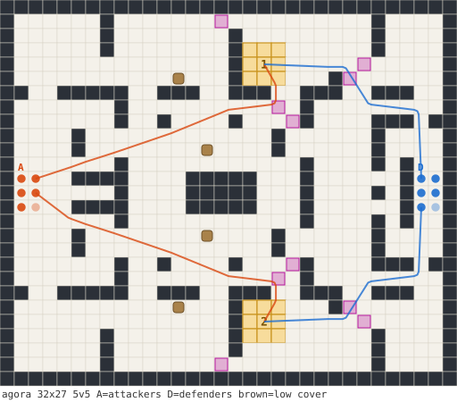 | 5v5, 32x27, 2 sites | 31 / 31 | 25 / 25 | 6 / 6 | 28 | 3 / 3 | 24.1 | 0 | 47.8% [43.6, 52.0] |
| [`bazaar`](../maps/bazaar.ibcmap)<br>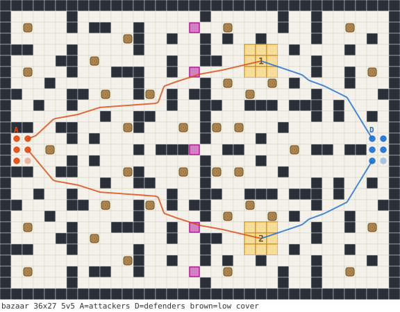 | 5v5, 36x27, 2 sites | 34 / 35 | 19 / 19 | 15 / 16 | 26 | 5 / 5 | 17.3 | 0 | 61.3% [55.7, 66.9] |
| [`crossfire`](../maps/crossfire.ibcmap)<br>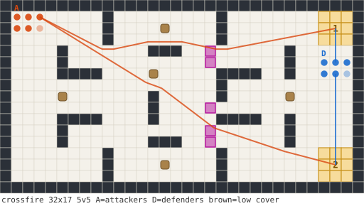 | 5v5, 32x17, 2 sites | 40 / 43 | 5 / 12 | 35 / 31 | 18 | 3 / 3 | 30.6 | 6 | 68.4% [63.2, 73.5] |
| [`culvert`](../maps/culvert.ibcmap)<br>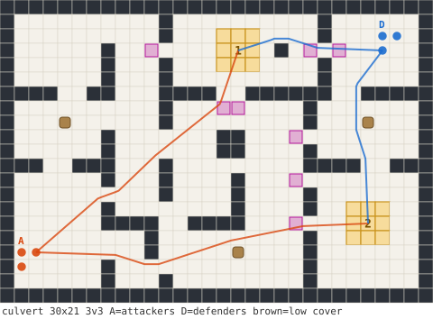 | 3v3, 30x21, 2 sites | 30 / 35 | 15 / 19 | 15 / 16 | 24 | 3 / 4 | 22.0 | 0 | 51.0% [46.0, 56.1] |
| [`delta`](../maps/delta.ibcmap)<br>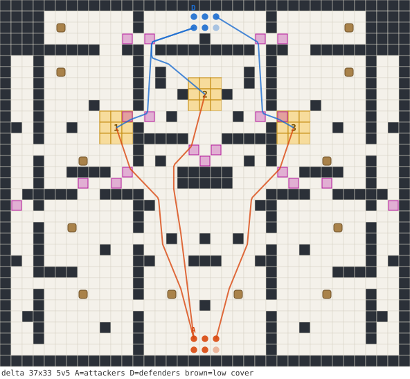 | 5v5, 37x33, 3 sites | 31 / 34 / 31 | 20 / 17 / 21 | 11 / 17 / 10 | 13 / 25 / 13 | 5 / 5 / 5 | 24.6 | 0 | 51.9% [47.8, 56.1] |
| [`fulcrum`](../maps/fulcrum.ibcmap)<br>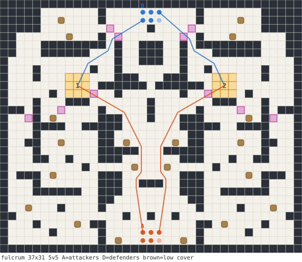 | 5v5, 37x31, 2 sites | 33 / 33 | 18 / 19 | 15 / 14 | 28 | 4 / 4 | 22.8 | 0 | 48.5% [43.5, 53.5] |
| [`longwatch`](../maps/longwatch.ibcmap)<br>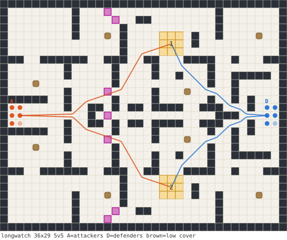 | 5v5, 36x29, 2 sites | 34 / 34 | 24 / 24 | 10 / 10 | 28 | 5 / 5 | 19.9 | 0 | 57.0% [52.5, 61.5] |
| [`postern`](../maps/postern.ibcmap)<br>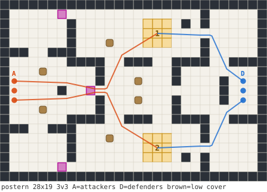 | 3v3, 28x19, 2 sites | 27 / 27 | 18 / 18 | 9 / 9 | 18 | 3 / 3 | 22.2 | 0 | 53.7% [48.0, 59.4] |
| [`quarry`](../maps/quarry.ibcmap)<br>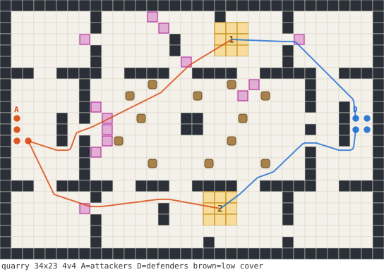 | 4v4, 34x23, 2 sites | 32 / 30 | 22 / 23 | 10 / 7 | 24 | 4 / 3 | 24.3 | 0 | 48.8% [44.1, 53.5] |
| [`spillway`](../maps/spillway.ibcmap)<br>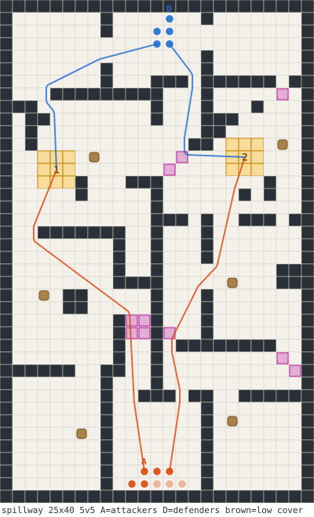 | 5v5, 25x40, 2 sites | 42 / 39 | 24 / 21 | 18 / 18 | 22 | 3 / 3 | 22.3 | 0 | 61.9% [57.6, 66.2] |
| [`steppe`](../maps/steppe.ibcmap)<br>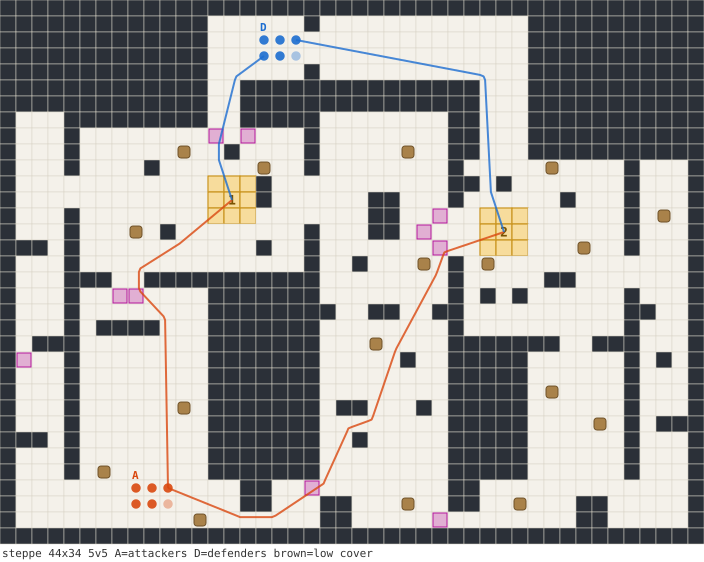 | 5v5, 44x34, 2 sites | 32 / 46 | 15 / 32 | 17 / 14 | 26 | 3 / 4 | 24.5 | 0 | 51.3% [47.6, 55.0] |
| [`trident`](../maps/trident.ibcmap)<br>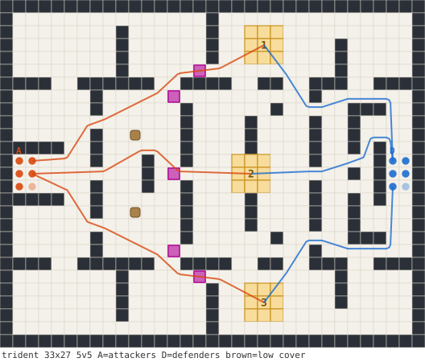 | 5v5, 33x27, 3 sites | 31 / 27 / 32 | 25 / 21 / 25 | 6 / 6 / 7 | 16 / 30 / 16 | 5 / 5 / 5 | 24.7 | 0 | 60.0% [55.0, 65.0] |
| [`tunnels`](../maps/tunnels.ibcmap)<br>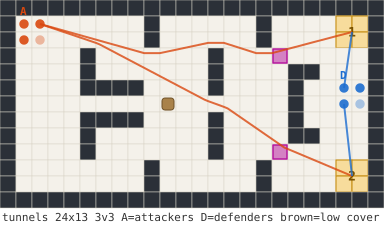 | 3v3, 24x13, 2 sites | 30 / 32 | 6 / 7 | 24 / 25 | 14 | 2 / 2 | 20.5 | 6 | 72.9% [68.6, 77.2] |
| [`warrens`](../maps/warrens.ibcmap)<br>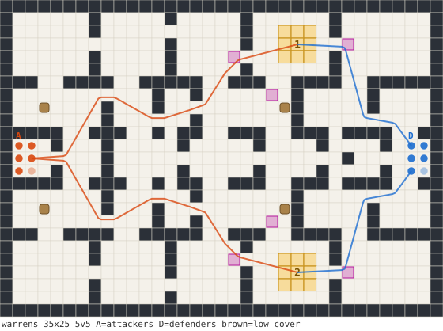 | 5v5, 35x25, 2 sites | 39 / 39 | 21 / 21 | 18 / 18 | 28 | 3 / 3 | 22.2 | 0 | 47.1% [42.4, 51.7] |

| Map | Identity |
|---|---|
| `agora` | Open middle with flanks. A plaza with a central block and pillars; both sites are reached from the plaza or along an outer lane. The most open map |
| `longwatch` | Lane map. Two long outer lanes (17 to 20 tile fights) around a cramped middle of small rooms with one-tile doors |
| `warrens` | Tight corridors. Rooms and one- and two-tile doors everywhere; three one-tile chokes per site; the only long lines are two cross-map alleys |
| `spillway` | Vertical split. Portrait map cut in two by a spine wall with a single crossing near the sites; attackers at the bottom, one site per side |
| `trident` | Three sites: one on the centre axis and one on each wing. Short hops between neighbours, a long rotation wing to wing |
| `delta` | Three sites, deep hub. Portrait, attackers south. The centre site is the deepest (advantage 17, against 6 on `trident`'s exposed centre) and sits in a walled keep whose two side doors are the only fast way between the wings: 13 ticks wing to keep, 25 wing to wing. Without the side doors it is 23 and 32, through the attackers' courtyard, so whoever holds the keep holds the rotation |
| `fulcrum` | Contested middle. Portrait, attackers south, sites west and east. Between the sites a ring room round a central pillar that both teams reach at about the same time (contact line across its middle). Rotation through it is 28 ticks; around it, through the defender spawn, 36, a retake today's fuse cannot cover (slack -1) |
| `steppe` | Large map, far site. 44x34, asymmetric. Site 1 is 15 ticks from the defender spawn; site 2 is 32 (the most in the pool) and 46 from the attackers, past an open field with low cover. A plant on site 2 leaves the defender spawn 2 ticks of slack today. The attack route to site 2 passes 12 tiles from the defenders' push, outside the 8-tile earshot guideline; accepted, since the far site is meant to be the quiet one (site 1, the nearer, passes at 0) |
| `bazaar` | Close quarters. Four perforated stall walls run the height of the map; each site is a walled court entered through five one-tile doors, with 34 low-cover crates across the map. Longest sightline 17.3 tiles, the shortest in the pool, so most fights are at SMG and shotgun range |
| `postern` | 3v3. Small and fast: three one-tile entrances per site, 18-tick rotation |
| `culvert` | 3v3, diagonal. Spawns in opposite corners, sites in the other two, so each site has a different timing |
| `quarry` | 4v4. A central pit full of low cover that you can shoot across but not run through, sites above and below it |
| `crossfire`, `tunnels` | The two original maps, unchanged (byte-identical). They predate the bands: defenders start next to the sites (advantage 24 to 35 ticks) and `crossfire` has 30-tile sightlines |

The "without" rotations for `delta` and `fulcrum` were measured on a copy of the map with those doors walled.

### `bazaar`, `delta`, `fulcrum` and `steppe` under the new timings

The timings called "incoming" below are now the rules (`rules/core.toml`: plant 12, defuse 21, kit defuse 16, fuse
80, buy phase 6), and the retake band moved with them to 26..51. "Now" in this section is the old ruleset. The
12-tile blast is not in the engine yet.

These four were drawn inside today's bands and checked against the timings the rules are moving to: plant 12,
defuse 21 (16 with a kit), fuse 80, and a charge that kills every unit within 12 tiles of it, walls or not. Slack
is fuse minus run minus defuse: "now" is today's 40-tick fuse and 7-tick defuse, "incoming" is `analyze` on a copy
of `rules/` with the four new numbers. The incoming fuse adds 26 ticks to every slack, so under it every map in the
pool, old and new, sits above the 0..25 band, which was tuned for today's fuse. Blast escape is the any-angle run
from the site centre to the nearest standable tile more than 12 tiles away (the `ibc-maptool` path code, not an
`analyze` field): on every new site a near-straight run gets out, so a defender who gives up a defuse needs 18 to
19 ticks to clear the blast.

| Map | Site | Blast escape (tiles / ticks) | Slack from nearest other site, now / incoming | Slack from defender spawn, now / incoming |
|---|---|---|---|---|
| `bazaar` | 1 | 12.4 / 19 | 8 / 34 | 15 / 41 |
| `bazaar` | 2 | 12.4 / 19 | 8 / 34 | 15 / 41 |
| `delta` | 1 | 12.2 / 18 | 22 / 48 | 15 / 41 |
| `delta` | 2 | 12.2 / 18 | 22 / 48 | 18 / 44 |
| `delta` | 3 | 12.2 / 18 | 22 / 48 | 14 / 40 |
| `fulcrum` | 1 | 12.3 / 18 | 7 / 33 | 17 / 43 |
| `fulcrum` | 2 | 12.3 / 18 | 7 / 33 | 16 / 42 |
| `steppe` | 1 | 12.0 / 18 | 8 / 34 | 19 / 45 |
| `steppe` | 2 | 12.1 / 18 | 8 / 34 | 2 / 28 |

### League with the reference bots

Measured 2026-11-25 on ruleset `0304dfc448350cca` (plant 12, defuse 21, kit defuse 16, fuse 80, buy phase 6):

```
ibc-bench balance --bots rusher,holder,utility,sapper,retaker,lurker,saver,forcer --maps maps --seeds 3
```

2688 games (2525 distinct), 29616 rounds. Every pair of bots plays every map on both
slots. `n` is the number of games behind the interval. The bots are described in `bots/README.md`.

| Map | Attackers win rounds | n |
|---|---|---:|
| `agora` | 47.8% [43.6, 52.0] | 192 |
| `bazaar` | 61.3% [55.7, 66.9] | 192 |
| `crossfire` | 68.4% [63.2, 73.5] | 192 |
| `culvert` | 51.0% [46.0, 56.1] | 192 |
| `delta` | 51.9% [47.8, 56.1] | 192 |
| `fulcrum` | 48.5% [43.5, 53.5] | 192 |
| `longwatch` | 57.0% [52.5, 61.5] | 192 |
| `postern` | 53.7% [48.0, 59.4] | 192 |
| `quarry` | 48.8% [44.1, 53.5] | 192 |
| `spillway` | 61.9% [57.6, 66.2] | 192 |
| `steppe` | 51.3% [47.6, 55.0] | 192 |
| `trident` | 60.0% [55.0, 65.0] | 192 |
| `tunnels` | 72.9% [68.6, 77.2] | 192 |
| `warrens` | 47.1% [42.4, 51.7] | 192 |

Over the whole pool attackers win 56.1% [54.8, 57.4] of rounds.

Read these with the bots in mind: they were written before the timings changed and have not been retuned.

- `crossfire` and `tunnels` stay attacker-sided (68% and 73%). They are the two original maps, where defenders
  spawn next to the sites, and they are the only two exempt from the bands.
- The four new maps sit between 48% and 61%. `bazaar` is the high one; its interval reaches 67%, so it is the
  one to watch.
- The older figures in this file's history (rusher against holder, 10 seeds) were for a ruleset that no longer
  exists and a two-bot pool; they are not comparable and were removed.
